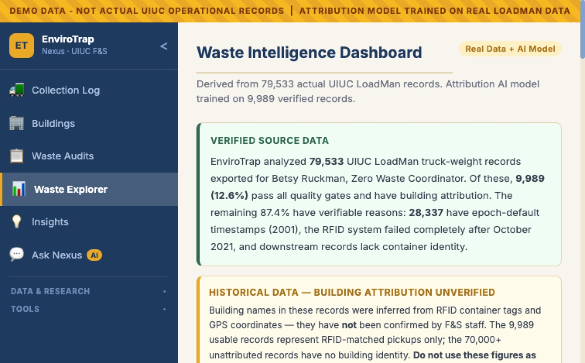
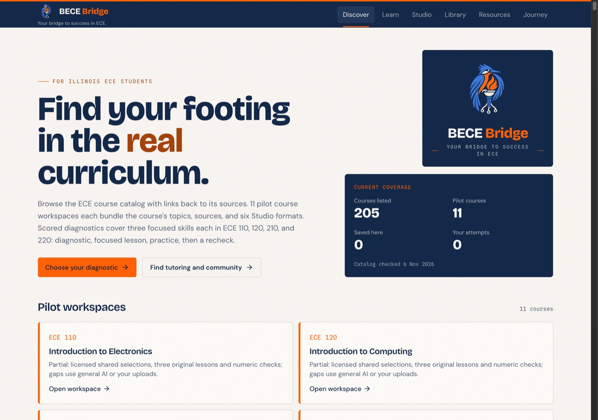

 

**Electrical Engineering + Innovation, Leadership & Engineering Entrepreneurship · UIUC**

I'm pursuing a dual degree in Electrical Engineering plus Innovation, Leadership & Engineering Entrepreneurship (ILEE) at the University of Illinois Urbana-Champaign. I'm interested in semiconductors, AI, quantum technology, and power and energy. I'm especially drawn to the engineering and entrepreneurship it takes to move an idea from the lab into real use.

My electrical engineering work at **Constellation Energy** has focused on two sides of engineering: design and strategic. Through both, it has consisted of project management, preventative maintenance planning, plant modernization and compliance, and nuclear cybersecurity at an operating nuclear power plant. As an **IBM SkillsBuild Student Ambassador at UIUC**, and the **first President of the IBM SkillsBuild UIUC collective**, I organize campus events and connect students with free learning resources and digital credentials across AI, quantum, cybersecurity, and thousands of other topics in tech and development.

I'm also a co-founder of **EnviroTrap**, a student-led research initiative where we're working with campus facilities staff to understand where waste comes from and give them better data to work with and connect to help operational decisions.

**Builder. Leader. Servant.**

*"Whatever you do, work at it with all your heart, as working for the Lord." (Colossians 3:23)*

🔗 [Portfolio](https://tj-pickett-pinex.netlify.app/links/) · [LinkedIn](https://www.linkedin.com/in/tjpickettpinexli/) · [EnviroTrap Nexus (flagship, below)](#-envirotrap-nexus) · 📧 [tpine3@illinois.edu](mailto:tpine3@illinois.edu)

 

## 🚩 EnviroTrap Nexus

**A three-tier attribution engine that closes a real 87.4% data gap in a university's waste-tracking records, built for the IBM AI for Good Challenge.**

Of the 79,533 waste-pickup records UIUC's LoadMan truck-weight system has logged since 2019, only 9,989 (12.6%) can be tied to a specific building; the trucks' RFID readers degraded from an 88.3% detection peak (April 2021) to 0% (August 2022) and never recovered. Nexus's three-tier engine (RFID lookup → GPS nearest-centroid model, validated at 84.8% top-1 accuracy on a held-out test set → explicit abstain) exists to close that gap without ever inventing an attribution the data can't support.

**One verified engineering decision:** every statistic in the app carries a provenance label (`Verified`, `AI-Inferred`, `Simulated`, `Unknown`), and when a QA pass caught the contamination-rate tile reusing the `Verified` label for audit-sampled data instead of RFID-confirmed data, the fix was a new `Audited` tier, not a quiet relabel: see the [write-up](https://github.com/tjppppppppp/projects/blob/main/envirotrap-nexus/README.md#what-broke-and-what-changed) and the [commit](https://github.com/tjppppppppp/projects/commit/0476326).

**Ask Nexus**, a deterministic Q&A module grounded in the real statistics (no LLM, no external calls), stays reachable from every view.

🔗 [Live demo](https://tjppppppppp.github.io/projects/envirotrap-nexus/) · [Source](https://github.com/tjppppppppp/projects/tree/main/envirotrap-nexus) · [Full case study](https://github.com/tjppppppppp/projects/blob/main/envirotrap-nexus/README.md)

 

## Selected work

<table>
<tr>
<td width="140" valign="top"></td>
<td valign="top">

**[BECE Bridge](https://github.com/tjppppppppp/projects/blob/main/projects/bece-bridge.md)**: Course-grounded study support for UIUC ECE students. Indexes a 205-course catalog and builds 11 of those into full pilot workspaces (ECE 110 → 342): upload your own lecture material, ask grounded questions, generate study plans and practice exams from that material. The API layer is backed by a real regression suite against a live Postgres schema, not mocks. [Live demo →](https://guest-persistence-hub.replit.app/)

</td>
</tr>
<tr>
<td width="140" valign="top"></td>
<td valign="top">

**[PortfolioIQ](https://github.com/tjppppppppp/projects/blob/main/projects/portfolio-iq.md)**: A no-login investing workspace built around a real CSV/screenshot importer: brokerage exports get mapped column-by-column, and you choose Add, Update, or Skip per row. Where cost basis is genuinely missing, it shows "gain not available" instead of inventing a number. [Live demo →](https://portfolio-iq-1.replit.app)

</td>
</tr>
</table>

 

## Tools these projects actually use

`React` · `TypeScript` · `Node.js` · `PostgreSQL + Drizzle` · `pnpm workspaces` · `Playwright` · `Astro` · `OpenAI-compatible AI integrations` · `GitHub Pages`

 

## Contact

📧 **Email:** [tpine3@illinois.edu](mailto:tpine3@illinois.edu)
💼 **LinkedIn:** [linkedin.com/in/tjpickettpinexli](https://www.linkedin.com/in/tjpickettpinexli/)
🌐 **Portfolio:** [tj-pickett-pinex.netlify.app/links](https://tj-pickett-pinex.netlify.app/links/)
